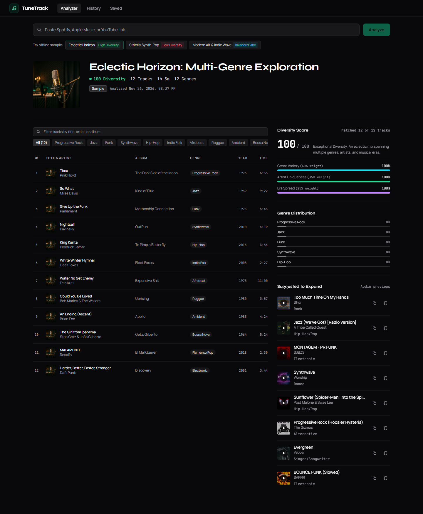

# TuneTrack

TuneTrack is a .NET 10 Blazor Web App that analyzes public playlists (or pasted tracklists) from Spotify, Apple Music, and YouTube Music, scores playlist diversity across genres, artists, and release eras, and suggests tracks with 30-second audio previews and bookmarks.





---

## Features

- **Playlist Link, Offline Samples & Manual Tracklist Analysis (`/`)**: Paste a public playlist URL, launch one of three built-in offline sample playlists (*Eclectic Horizon*, *Strictly Synth-Pop*, *Modern Alt & Indie Wave*), or fall back to pasting one `Artist - Title` per line. Includes instant text search and genre filter chips across analyzed tracks.
- **Weighted Diversity Score (`0–100`)**: Calculated by `DiversityScorer` across three sub-scores:
  - **Genre Variety (40%)**: Normalized Shannon entropy over distinct genres on matched tracks (`min(matchedTracks, 8)` buckets; `0` when zero or one genre is present).
  - **Artist Uniqueness (35%)**: Ratio of distinct normalized artist credits to total tracks (`distinctArtists / trackCount × 100`).
  - **Era Spread (25%)**: Up to `60` points from distinct release decades (capped at `5` decades) plus up to `40` points from release-year span (capped at `40` years).
  - **Coverage Transparency**: Shows `Matched X of Y tracks` on the scorecard, adds a `Based on X of Y tracks` notice when strictly under half of the playlist has metadata, displays `Not enough data` instead of a numeric score at `0` matches, and shows `— Genres` when zero genres match.
- **Tailored Suggestions (`/`, `/saved`)**: Generates up to 8 track recommendations via the iTunes Search API excluding artists and titles already in the playlist (expanding into adjacent genres when the playlist score is below `40`). Each suggestion includes 30-second audio preview playback, one-click `Title — Artist` clipboard copy, and bookmark toggling persisted to **Saved** (`/saved`).
- **Per-Browser History (`/history`)**: Saves completed analyses (skipping partial or zero-metadata runs) scoped to a `localStorage` client UUID and renders analysis timestamps in the viewer's local timezone.

---

## Platform Support

| Platform | What Is Retrieved | Known Limits | Paste-Tracklist Fallback |
|---|---|---|---|
| **Spotify** | Reads public embed HTML (`open.spotify.com/embed/playlist/{id}` `__NEXT_DATA__`) for title, cover, track titles, artists, and durations, then enriches up to `100` tracks via iTunes Search (with a `country=PH` fallback pass). | Tracks absent from iTunes keep title/artist/duration without genre/year/album; unauthenticated embeds/iTunes calls remain subject to upstream rate limits (`429`/`403`). | Falls back to Spotify oEmbed title/cover + `'Artist - Title'` paste form if embed track data is unavailable. |
| **Apple Music** | Reads public `music.apple.com/{country}/playlist/...` HTML (`serialized-server-data`, falling back to `music:song` meta / JSON-LD IDs) for real titles, artists, albums, durations, and numeric track IDs, then resolves up to `100` tracks in batches of `50` via Apple's keyless `itunes.apple.com/lookup?id=...&country={storefront}` endpoint. | Requires the link to be a public `/playlist/` page with recoverable artist credits for the majority of tracks. Storefront is derived from the URL path. | Album (`/album/`), single-song (`/song/`), or majority-unknown-artist pages return the partial header/cover state with the paste form. |
| **YouTube Music** | Paste-only in typical use because YouTube Music playlists generally do not expose structured track lists publicly to unauthenticated requests. `YouTubeMusicPlaylistProvider` attempts a best-effort parse of `ytInitialData` via `youtube.com/playlist?list=...` (`- Topic` channels or `Artist - Title` video titles, up to `100` tracks enriched via iTunes Search) before falling back. | Region/consent gates, non-music uploads, or private/unlisted YouTube Music lists expose no structured tracks. | Returns the partial playlist header/cover and prompts to paste tracks (`Artist - Title`, one per line). |

---

## Run Locally

### Prerequisites

- [.NET 10 SDK](https://dotnet.microsoft.com/download/dotnet/10.0)
- [Node.js](https://nodejs.org/) (includes `npm`; building the project automatically runs `npm ci` if `node_modules` is missing and compiles Tailwind CSS via `npm run build:css`)

### Start the App

```bash
dotnet run --project src/TuneTrack
```

### EF Core In-Memory Fallback Mode

If `ConnectionStrings:DefaultConnection` is missing, empty, or contains a placeholder token (`YOUR_PASSWORD`, `[PASSWORD]`, `changeme`, `<password>`), `Program.cs` starts cleanly in **EF Core In-Memory** mode (`TuneTrackInMemory`) and logs a startup warning. The analyzer and suggestions still work normally, **but all History and Saved bookmarks live in memory only and are lost when the process restarts**.

---

## Database Setup (Supabase PostgreSQL)

TuneTrack uses Entity Framework Core 10 with `Npgsql.EntityFrameworkCore.PostgreSQL`.

### 1. Get the Session Pooler Connection String

In your Supabase project dashboard:
1. Open **Project Settings** > **Database**.
2. Under **Connection Pooling**, select **Session mode** (port `5432`).
3. Use `.NET` key-value format with `SSL Mode=Require;`:

```text
Host=aws-0-[region].pooler.supabase.com;Port=5432;Database=postgres;Username=postgres.[project-ref];Password=[YOUR_PASSWORD];SSL Mode=Require;
```

### 2. Configure via .NET User Secrets

Store the connection string locally via `dotnet user-secrets` so credentials are never committed to source control:

```bash
dotnet user-secrets init --project src/TuneTrack
dotnet user-secrets set "ConnectionStrings:DefaultConnection" "Host=aws-0-[region].pooler.supabase.com;Port=5432;Database=postgres;Username=postgres.[project-ref];Password=your_actual_password;SSL Mode=Require;" --project src/TuneTrack
```

### 3. Apply Migrations

At runtime, `Program.cs` calls `db.Database.Migrate()` on startup whenever a non-placeholder connection string is configured. To apply migrations manually with the repo's local `dotnet-ef` manifest (`dotnet-tools.json`):

```bash
dotnet tool restore
dotnet ef database update --project src/TuneTrack --connection "Host=aws-0-[region].pooler.supabase.com;Port=5432;Database=postgres;Username=postgres.[project-ref];Password=your_actual_password;SSL Mode=Require;"
```

> **Note:** `src/TuneTrack/Data/AppDbContextFactory.cs` uses a local `localhost` default for design-time scaffolding and does not read `user-secrets`, so pass `--connection` explicitly when running `dotnet ef database update` against Supabase.

### 4. Enable Row Level Security (RLS)

TuneTrack accesses Postgres server-side over Npgsql, so remember to **enable Row Level Security (RLS)** on `AnalyzedPlaylists`, `AnalyzedTracks`, and `SavedRecommendations` in your Supabase dashboard so those tables are not left publicly readable or writable through Supabase's PostgREST/Data API.

---

## Tests

Run the full xUnit suite (`tests/TuneTrack.Tests`):

```bash
dotnet test
```

What the `38` unit tests cover (using EF Core In-Memory and stubbed `HttpMessageHandler` HTTP fixtures — no live network required):

- **`DiversityScorerTests`**: Weighted `40 / 35 / 25` scoring, empty/single-track safety, and handling missing genres or release years.
- **`FallbackTrackListParserTests`**: `'Artist - Title'` parsing across dashes (`-`, `–`, `—`), numbered tracklists (`1.`, `1)`), whitespace normalization, and preserving numeric artist names (e.g. `50 Cent`).
- **`TrackEnricherServiceTests`**: iTunes genre normalization, artist matching (featuring credits, hyphenated names like `Flow-G`, reordered collaborators, wrong-artist rejection), title suffix cleaning, `429`/`403`/timeout retry backoff without negative-cache poisoning, `country=PH` fallback storefront pass, and comma-separated `/lookup` ID batching & caching.
- **`PlaylistAndProviderTests`**: Spotify `__NEXT_DATA__` parsing, YouTube `ytInitialData` parsing, Apple Music trimmed real HTML fixture parsing (`serialized-server-data`, storefront ID resolution, meta-ID-only fallback, unknown-artist partial fallback, `/album/` & `/song/` partial handling), zero-track/zero-metadata History exclusion, and bookmark save/toggle/error logging.
- **`RecommendationEngineTests`**: Deduplication, excluding playlist artists/tracks, round-robin genre sampling, and adjacent-genre exploration when Diversity Score `< 40`.
- **`SamplePlaylistServiceTests`**: Offline local artwork paths under `wwwroot/images/samples/` and derived metadata accuracy.

---

## Project Structure

```text
TuneTrack.slnx
dotnet-tools.json              # Local dotnet-ef tool manifest (v11.0.0)
package.json                   # Tailwind CSS build & Playwright/Puppeteer devDependencies
tailwind.config.js
README.md
scripts/
  verify-ui.js                 # Automated Puppeteer UI check & screenshot runner
docs/
  design-system.md             # Typography, palette tokens, and layout guidelines
  plans/                       # Feature and fix implementation plans
  screenshots/                 # 1440px and 390px rendered UI captures
src/
  TuneTrack/
    Components/
      Layout/                  # MainLayout navigation shell & SignalR ReconnectModal
      Pages/                   # Home (/), History (/history), Saved (/saved), Error, NotFound
    Data/                      # AppDbContext & design-time AppDbContextFactory
    Migrations/                # EF Core PostgreSQL migrations
    Models/                    # AnalyzedPlaylist, AnalyzedTrack, SavedRecommendation
    Services/
      Analysis/                # IDiversityScorer, DiversityScorer
      Providers/               # Spotify, Apple Music, YouTube Music providers, FallbackTrackListParser, PlaylistService
      Recommendations/         # IRecommendationEngine, RecommendationEngine, TrackEnricherService
      Samples/                 # ISamplePlaylistService, SamplePlaylistService
    Styles/                    # Tailwind CSS input (app.css)
    wwwroot/                   # Static images, JS interop (tunetrack.js), compiled css/app.css
    Program.cs
    TuneTrack.csproj
tests/
  TuneTrack.Tests/
    Fixtures/                  # Trimmed saved HTML test fixtures
    *Tests.cs                  # xUnit tests across analysis, providers, enrichment & recommendations
```

---

## Known Limitations

- **Incomplete upstream metadata**: Not every track exists in Apple's iTunes Search / Lookup catalog (such as unreleased, Spotify-exclusive, or regional tracks); unmatched tracks keep their track title/artist/duration when parsed, carry no genre/year/album, and do not contribute to genre scoring or genre distribution percentages. Repeated uncached playlist enrichment bursts can also hit upstream iTunes `429`/`403` rate limits.
- **No user authentication**: There are no user accounts; Analysis History (`/history`) and Saved bookmarks (`/saved`) are scoped per browser via a generated `localStorage` client ID (`tunetrack_client_id`).
- **Public-link dependency**: Link parsing relies on public, unauthenticated web pages (`open.spotify.com/embed`, `music.apple.com`, `youtube.com/playlist`) whose HTML or structured payloads can change upstream without notice.

---

## Tech Stack

.NET 10 · Blazor Web App (Interactive Server) · Entity Framework Core 10 · Npgsql (PostgreSQL / Supabase + EF Core In-Memory) · Tailwind CSS · xUnit · Puppeteer-core

*Built using an AI-assisted engineering workflow with written implementation plans (`docs/plans/`), TDD checks, and automated browser verification.*
