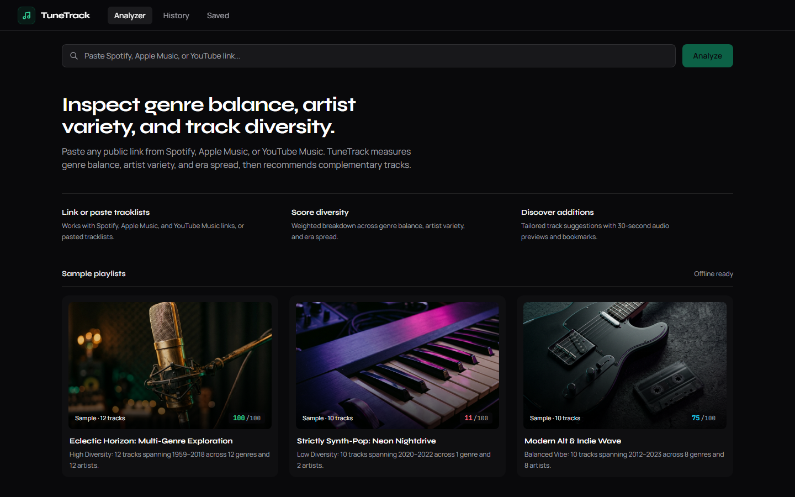
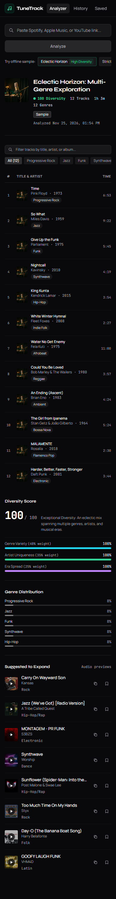

# TuneTrack

TuneTrack is a .NET 10 Blazor Web App that analyzes public playlists (or pasted tracklists) from Spotify, Apple Music, and YouTube Music, scores playlist diversity across genres, artists, and release eras, and suggests tracks with 30-second audio previews and bookmarks.






## Quick start

**Prerequisites:** [.NET 10 SDK](https://dotnet.microsoft.com/download/dotnet/10.0) and [Node.js](https://nodejs.org/).

```bash
dotnet run --project src/TuneTrack
```

Open the local URL printed in the terminal and click one of the three sample playlists to try it with no account or database.

---

## Features

- **Link, sample & tracklist analysis (`/`)**: Paste a public playlist URL, launch an offline sample playlist (*Eclectic Horizon*, *Strictly Synth-Pop*, or *Modern Alt & Indie Wave*), or paste `'Artist - Title'` lines when track metadata isn't exposed. Filter tracks live by text or genre chips.
- **Diversity Scorecard**: Summarizes genre balance, artist variety, and era spread out of `100`, with coverage indicators (`Matched X of Y tracks`, `Based on X of Y tracks` under half coverage, `Not enough data` at zero matches, and `— Genres` when zero genres match).
- **Track suggestions (`/`, `/saved`)**: Suggests up to 8 new tracks (via iTunes Search, widening to adjacent genres when the score is under `40`) with 30-second audio previews, one-click `Title — Artist` copy, and bookmark toggling saved to **Saved** (`/saved`).
- **History (`/history`)**: Records completed analyses per browser and formats timestamps in the viewer's local timezone.

### How the score works

`DiversityScorer` computes a `0–100` weighted total from three sub-scores:

- **Genre Variety (40%)**: Normalized Shannon entropy over distinct genres on matched tracks (`min(matchedTracks, 8)` buckets; `0` when zero or one genre is present).
- **Artist Uniqueness (35%)**: Ratio of distinct normalized artist credits to total tracks (`distinctArtists / trackCount × 100`).
- **Era Spread (25%)**: Up to `60` points from distinct release decades (capped at `5` decades) plus up to `40` points from total release-year span (capped at `40` years).

---

## Platform Support

| Platform | What Is Retrieved | Known Limits | Paste-Tracklist Fallback |
|---|---|---|---|
| **Spotify** | Reads public embed HTML (`open.spotify.com/embed/playlist/{id}` `__NEXT_DATA__`) for title, cover, track titles, artists, and durations, then enriches up to `100` tracks via iTunes Search (with a `country=PH` fallback pass). | Tracks absent from iTunes keep title/artist/duration without genre/year/album; unauthenticated embeds and iTunes calls remain subject to upstream rate limits (`429`/`403`). | Falls back to Spotify oEmbed title/cover + `'Artist - Title'` paste form if embed track data is unavailable. |
| **Apple Music** | Reads public `music.apple.com/{country}/playlist/...` HTML (`serialized-server-data`, falling back to `music:song` meta / JSON-LD IDs) for real titles, artists, albums, durations, and numeric track IDs, then resolves up to `100` tracks in batches of `50` via Apple's keyless `itunes.apple.com/lookup?id=...&country={storefront}` endpoint. | Requires a public `/playlist/` page with recoverable artist credits for the majority of tracks. Storefront is derived from the URL path. | Album (`/album/`), single-song (`/song/`), or majority-unknown-artist pages return the partial header/cover state with the paste form. |
| **YouTube Music** | Paste-only in typical use because YouTube Music playlists generally do not expose structured track lists publicly to unauthenticated requests. `YouTubeMusicPlaylistProvider` attempts a best-effort parse of `ytInitialData` via `youtube.com/playlist?list=...` (`- Topic` channels or `Artist - Title` video titles, up to `100` tracks enriched via iTunes Search) before falling back. | Region/consent gates, non-music uploads, or private/unlisted YouTube Music lists expose no structured tracks. | Returns the partial playlist header/cover and prompts to paste tracks (`Artist - Title`, one per line). |

---

## Run Locally

**Prerequisites:** [.NET 10 SDK](https://dotnet.microsoft.com/download/dotnet/10.0) and [Node.js](https://nodejs.org/) (building automatically installs npm devDependencies if `node_modules` is missing and compiles Tailwind CSS).

```bash
dotnet run --project src/TuneTrack
```

> **Data storage:** By default, History and Saved bookmarks are kept in memory (`TuneTrackInMemory`) and reset when the app restarts. The app can persist to PostgreSQL if `ConnectionStrings:DefaultConnection` is configured.

---

## Demo Tips

- History and Saved bookmarks are scoped per browser (`localStorage` client ID) and reset on app restart in the default in-memory mode.
- Upstream iTunes Search / Lookup requests can temporarily rate-limit (`429`/`403`) during rapid repeated analyses of large uncached playlists.
- Some tracks (such as unreleased, Spotify-exclusive, or regional tracks) have no iTunes match and appear without genre, release year, or album metadata.

---

## Tests

Run the full xUnit suite (`tests/TuneTrack.Tests`):

```bash
dotnet test
```

What the `38` unit tests cover (using EF Core In-Memory and stubbed HTTP responses — no live network or database required):

- **`DiversityScorerTests`**: Weighted `40 / 35 / 25` scoring, empty/single-track safety, and handling missing genres or release years.
- **`FallbackTrackListParserTests`**: `'Artist - Title'` parsing across dashes (`-`, `–`, `—`), numbered lists (`1.`, `1)`), whitespace normalization, and preserving numeric artist names (e.g. `50 Cent`).
- **`TrackEnricherServiceTests`**: iTunes genre normalization, artist matching (featuring credits, hyphenated names like `Flow-G`, reordered collaborators, wrong-artist rejection), title cleaning, `429`/`403`/timeout backoff without negative-cache poisoning, `country=PH` fallback pass, and batch `/lookup` by ID with caching.
- **`PlaylistAndProviderTests`**: Spotify `__NEXT_DATA__`, YouTube `ytInitialData`, Apple Music trimmed HTML parsing (`serialized-server-data`, storefront ID resolution, meta-ID fallback, unknown-artist partial fallback, `/album/` & `/song/` partial handling), History exclusion guards, and bookmark save/toggle/error logging.
- **`RecommendationEngineTests`**: Deduplication, excluding existing tracks/artists, round-robin genre sampling, and adjacent-genre expansion when score `< 40`.
- **`SamplePlaylistServiceTests`**: Offline cover asset paths and derived metadata consistency.

---

## Project Structure

```text
TuneTrack.slnx
dotnet-tools.json              # Local dotnet-ef tool manifest (v11.0.0)
package.json                   # Tailwind CSS, PostCSS, Autoprefixer & Puppeteer-core devDependencies
tailwind.config.js
README.md
scripts/
  verify-ui.js                 # Automated Puppeteer-core UI check & screenshot runner
docs/
  design-system.md             # Typography, palette tokens, and layout guidelines
  plans/                       # Feature and fix implementation plans
  screenshots/                 # 1440px and 390px rendered UI captures
src/
  TuneTrack/
    Components/
      Layout/                  # MainLayout navigation shell & SignalR ReconnectModal
      Pages/                   # Home (/), History (/history), Saved (/saved), Error, NotFound
    Data/                      # AppDbContext & design-time AppDbContextFactory
    Migrations/                # EF Core PostgreSQL migrations
    Models/                    # AnalyzedPlaylist, AnalyzedTrack, SavedRecommendation
    Services/
      Analysis/                # IDiversityScorer, DiversityScorer
      Providers/               # Spotify, Apple Music, YouTube Music providers, FallbackTrackListParser, PlaylistService
      Recommendations/         # IRecommendationEngine, RecommendationEngine, TrackEnricherService
      Samples/                 # ISamplePlaylistService, SamplePlaylistService
    Styles/                    # Tailwind CSS input (app.css)
    wwwroot/                   # Static images, JS interop (tunetrack.js), compiled css/app.css
    Program.cs
    TuneTrack.csproj
tests/
  TuneTrack.Tests/
    Fixtures/                  # Trimmed saved HTML test fixtures
    *Tests.cs                  # xUnit tests across analysis, providers, enrichment & recommendations
```

---

## Known Limitations

- **Incomplete upstream metadata**: Not every track exists in Apple's iTunes Search / Lookup catalog; unmatched tracks are excluded from genre diversity and distribution calculations, and rapid uncached bursts can hit upstream rate limits.
- **Per-browser storage only**: There are no user accounts or sign-in; History and Saved bookmarks are isolated per browser via `localStorage` (`tunetrack_client_id`).
- **Public-link dependency**: Playlist fetching relies on unauthenticated public pages (`open.spotify.com/embed`, `music.apple.com`, `youtube.com/playlist`) whose markup can change upstream.

---

## Tech Stack

.NET 10 · Blazor Web App (Interactive Server) · Entity Framework Core 10 (In-Memory default + optional PostgreSQL via Npgsql) · Tailwind CSS · xUnit · Puppeteer-core

*Built with an AI-assisted engineering workflow using implementation plans in `docs/plans/`, TDD unit checks, and automated Puppeteer-core browser verification.*
